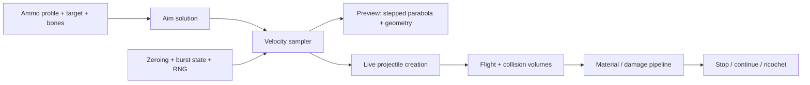

# Aiming, shot distribution, trajectory queries and projectiles — build 25492057

Static evidence only. Addresses are RVAs in the fingerprinted Windows x64
executables. This pass follows the engagement map into the actual shot. The
companion manifest records reviewed contracts/slices, not complete knowledge of
every exported function. No game/editor execution or binary modification occurred.

## What a replacement decision layer would need

The firing decision depends on more than a target and an accuracy number:

- Current ammunition selects speed, gravity, spread, damage and range profiles.
- Aiming solves a trajectory subject to the weapon's bone geometry. It can change
  speed and gravity multipliers, rather than merely rotate a muzzle.
- Shot distribution has zeroing, burst memory, anisotropic spread, vertical
  adjustment and a branch which solves a new trajectory to a displaced target.
- The trajectory preview is a geometry query. Live projectiles additionally
  process materials, penetration, ricochets, reactive flight, `atgm` guidance and
  distance-dependent falloff. These are different contracts.
- Preview sampling is stateful: even with spread disabled it consumes random
  draws and can reset burst counters/centers. Calling it as a read-only predicate
  would be an incorrect assumption.
- Place readiness includes occupied controller slots. A successful aim alone
  does not mean the crew is ready to shoot.

## Aiming modes and profile inputs

Parser `82CD60`, registry `1581710`, token `AimType=BA` writes weapon definition
`+1608`: `direct=0`, `curved=1`, `adaptive=2`, `nocurve=3`. These names come from
literal string comparisons, not an inferred enumeration. Unknown names diagnose
`Unknown aim type`. `827FA0` returns the field; `828050` tests mode 3.

`827ED0/827F30` select a profile through `829140(definition+1600,ammo+868 tags)`,
or the empty/default tag object when no ammo exists. They return float gravity
`+78` and speed `+260`. `827E30/827E70` multiply those by aimer double scales
`+158/+150`. Native return values are in XMM0 even where Ghidra prints integers.

Selected configuration bindings:

| Parser | Configuration | Destination |
|---|---|---|
| `82A5C0` | Range / AimRange | Profile `+20` aim distance, spatially scaled; Range also writes `+24` maximum |
| `82A5C0` | MinRange / MaxRange | Profile `+28/+24`, spatially scaled; missing numeric arguments give 0 / huge maximum |
| `82A5C0` | Gravity | Profile `+78=max(input,0)` |
| `82D390` | Speed | Profile `+260=input*1547DB0` velocity scale |
| `82D390` | FalloffMeter / FalloffStrength | Profile `+268/+26C`, raw floats |
| `82D390` | TraceFreq | Profile `+118`, integer |
| `82D390` | RicochetDamageClip | Profile `+11C`, float |
| `82D390` | RicochetEnergyDamping | Profile `+120/+128/+130` table, angle X converted from degrees to radians and sorted |
| `82CD60` | DisableRicochet | Definition `+1648`, bool |
| `82CD60` | Calibre | Definition `+1628`, float; missing zero may be filled from a `bullet…` tag |
| `82CD60` | LockFireDistanceTime | Definition `+164C`, float; after-shot `81AF10` sets shooter deadline `+24` |

`822A90` is bullet-aimer slot 17. Its context contains target doubles `+80..90`,
output unit direction `+B8..C8`, speed/gravity scales `+D0/+D8`, success byte
`+E0`. The parent preparation initializes scales to 1 and success to false.

- **direct:** fixed-speed ballistic solver `5E8290`, using profile speed and
  negative scaled gravity. It initially uses the first, lower-elevation solution.
  Non-negligible gravity and weaponry `+89==0` also invoke bone adjustment `827B50`.
- **curved/adaptive:** let `q=clamp(distance3D/defaultProfile.aimRange,0,1)`.
  For owner type bit2 set, elevation is `30°*q` and gravity scale remains 1.
  Otherwise curved uses elevation `85°-35°*q` and gravity scale `1-0.7*q`;
  adaptive uses line-of-sight elevation plus `45°*q`, gravity scale 1.
  `5E7E80` solves the speed needed at that elevation. A positive result establishes
  success, triggers bone adjustment, and is divided by profile speed for `+D0`.
  In this caller the final store uses the locally computed speed after adjustment;
  it must not be described as blindly preserving every adjustment write to `+D0`.
- **nocurve:** normalizes target minus origin, uses an axis fallback for a near-zero
  vector, sets both scales to 1 and success true. This is an aiming mode; it does
  not itself prove that the live projectile has zero gravity.

`5E8290` returns 0, 1 or 2 records, each `0x20` bytes: time followed by double XYZ
unit direction. For nonzero gravity magnitude `g`, horizontal distance `D`,
height difference `z` and speed `v`, its discriminant is
`v^4-g*(g*D^2+2*z*v^2)`; tangent elevations are `(v^2∓sqrt(discriminant))/(D*g)`.
The lower solution comes first; a zero discriminant gives one solution. It rejects
a near-zero speed and a NaN square root. Near-zero gravity takes the straight
normalization branch. Near-vertical displacement is perturbed by adding about
0.1 to X before solving. Preserve these degeneracy rules in any emulation.

`5E7E80` builds direction from azimuth and the requested elevation, solves time
from the vertical residual and gravity, then recovers speed from X or Y. It returns
-1 for its rejected geometry cases. It is not a second fixed-speed solver.

`822F60` copies context target to aimer `+60..70`; success copies scales to
`+150/+158`, failure resets them to 1. It copies context direction to `+138..148`
only when success and `+E3` are both true; otherwise it uses current bone direction
`81DAD0`. `827E60` returns the address of this cached direction.

### Bone geometry boundary

`822290` resolves the muzzle and optional parent revolute bone into context
`+98/+A8`, processes limits, computes geometric direction/origin through `823470`,
then calls slot17. Failure restores the muzzle direction. `823470` transforms
the target/ray into the bone frame and solves alternative geometric intersections;
the branch at global `1480F90` selects two implementations. It handles socket
bones specially and returns an unchanged direction/origin with false when the
applicable bone flag predicate fails. The entire geometry solver is **not** yet
claimed as a recovered public API.

`827B50` iterates `5C5760/5C5400` at most three times, stopping on sufficiently
small or non-improving error. Parametric-bone type/slot23 and an angular threshold
decide whether to set context `+E2` or try another fixed-elevation speed solution.
These helpers still need the bone property/limit producer pass. Trial geometry
and current physical bone orientation must not be conflated.

## Shot sampler `818A10`

Inputs are shooter, output double XYZ velocity, and an apply-spread boolean.
It refreshes cached spread settings (`81B510`) and normalizes aimer slot7 direction.
It compares that direction with aimer `+48..58` using a clamped dot/acos. A special
ballistic branch is enabled by aimer `+11C` and angular error below
`max(AimingTolerance,1547DE0 angular scale)`.

The distance fed to spread-radius evaluation is actual target distance in that
branch; otherwise it is mode1 target position `weapon+154` distance or the default
profile aim range. Its cone-angle denominator is a separate value: ballistic arc
length in the special branch, ordinary distance otherwise.

`5E8050` calculates arc length for horizontal travel `D`, horizontal velocity `h`,
vertical velocity `w` and gravity `g`. With `k=-g/h²`, `u0=w/h`, `u1=u0+kD`,
it returns `[F(u1)-F(u0)]/k`, where
`F(u)=0.5*(u*sqrt(1+u²)+log(abs(u+sqrt(1+u²))))`.
Near-zero gravity uses Euclidean origin/target distance. No extra horizontal-speed
guard should be invented from the mathematical idealization.

For a fresh sample:

1. A nonzero BurstCount `N` resets shooter `+1C` and chooses burst limit
   `+3F4 = N/2 + randomInteger % (N-N/2)` using integer division.
2. Read BurstAccuracy indexed by `min(+1C,lastIndex)`, clamp to at least 0.01 and
   take its reciprocal `b`. Empty vector gives 1.
3. Spread radius `r` is zero when spread is disabled; otherwise it is
   `818970(zeroing)*shooter.slot8(distance)`.
4. Draw radial factor `rho=(U*b)^(Power/2)` and independent azimuth `phi=2πU`.
   Cone displacement is `theta=rho*atan2(r,arcLengthOrDistance)`.

A fresh sample occurs if spread is disabled, BurstCount is zero, current burst
count is zero, or current count exceeds `+3F4`. Consequently disabled-spread
queries still reset/count burst state and consume RNG. Random state uses the
previously mapped per-context LCG and draw counter; a preview is not pure.

If the special ballistic branch is active and mode is not nocurve, the sampler
displaces the target in a plane based on its estimated arrival direction, then
solves a fixed-speed trajectory to the displaced target. It chooses the solution
with the smallest angle from the original muzzle direction and converts it back
to local angular offsets. The arrival estimate subtracts gravity using
**3D origin-to-target distance divided by horizontal speed**. Do not silently
substitute horizontal distance in this branch when reproducing engine behavior.

For BurstCount nonzero, it stores a plane-space center `+3E4/+3E8` from
`tan(theta)*R*(cos(phi),sin(phi))`, where `R=80A910` unless weapon flag bit3
substitutes the large sentinel. A second random point on the same circle sets
normalized drift `+3EC/+3F0`, scaled by BurstDelta. Continuing samples add that
drift. With spread enabled, an additional random azimuth and radius
`U*BurstWidth` are added to the center before converting back to angles.

The final frame uses muzzle yaw/polar angle, negative SpreadYAdjustment and
SpreadXYRatio: ratios <=1 scale one transverse axis; ratios >1 scale the other
by the reciprocal. `81C000` produces local velocity
`speed*(sin(theta)*cos(phi),sin(theta)*sin(phi),cos(theta))`; the frame transforms
it. Assembly confirms there is **no final normalization after the anisotropic
transform**. Thus the returned magnitude is not guaranteed to equal profile speed.
`81BC30` builds an orthogonal frame using forward and hint vectors with an axis
fallback; `81BF20` rotates each basis vector's XY components by yaw.

## Geometry preview

Shooter slot3 `818770` clears output collisions, calls the sampler with spread
disabled, obtains aimer slot6 origin, constructs a 0x60-byte query, sets flags,
optional path-vector and gravity, then executes it. Argument 3 is unused in this
implementation. The cleanup `83A620` is empty.

| Query offset | Representation | Role |
|---|---|---|
| `+0` | float | Curvature tolerance squared: `(0.1*spatialScale)^2` |
| `+4/+8` | int32 | Adaptive step / accumulated time; initial step truncates `0.02*timeScale` |
| `+C/+10` | float | Gravity / accumulated path length |
| `+14` | uint32 | Flags, default `6003` |
| `+18` | pointer | Owner/exclusion input |
| `+20/+2C/+38` | float XYZ | Initial position / velocity / current position |
| `+44/+48` | float pair | Optional trajectory-frame offset, defaults from zero vector |
| `+50/+58` | pointer | Collision-vector / optional path-vector |

`83A510` replaces flags if either low bit of the argument is set; otherwise ORs
them. `83A530` exits when both horizontal velocity components are negligible,
including a vertical-only trajectory. Otherwise it calls `83A630` until false,
adds a final path point if requested, and sorts records when flag `400000` is set.

`83B040` evaluates `origin+velocity*t-(0,0,gravity*t²/2)` and, if the optional
offset pair differs from defaults, adds an offset in the instantaneous velocity
frame. `83A630` advances integer time by the current step, computes endpoint and
midpoint, and measures deviation from the segment midpoint. Excess curvature
halves the step; sufficiently low double-interval error doubles it. A new step
below 2 ends the query. The already computed endpoint uses the old step; adjusting
the next step does not recalculate that endpoint. Assembly was necessary to see
that the decompiler's apparent overwriting of the endpoint with an error vector
is false: those subtractions stay in XMM registers.

`83A850` builds a geometry query through `A21E50/A21EB0/A21F50`, producing 0x48-byte
records. It can refine time around a first collision and requery the shortened
segment. It copies selected records to the output and converts segment distance
to cumulative path distance. Non-volume kinds1/2 produce a terminal kind1 record.
For volume records, flag14 selects volume `+C` bit1 and flag23 selects bit2;
both require volume `+28` bit5 clear. Selected volume collisions terminate unless
query flag22 (`400000`) requests collection. The outer step also asks the owner-
specific region `A27FD0` whether the old/new segment leaves its permitted bounds
through `A26850`. Full geometry flag names and region ownership remain open.

The preview does not call live projectile material/damage processing and does
not model the live `FalloffStrength` correction described below.

## Firing gate and controller occupancy

`817F70` verifies shooter readiness/range, charger flags `+14 & 14`, animation
transition state and place readiness before slot11. Outside weapon mode1 the
accepted aimer states are 3/4, or 2/5 when shooter slot9 is false. The full animation
producer and charger state machine remain separate work.

`8107D0` tail-calls `781D50(owner+568,place+2C8)`. This is a boolean return despite
the initial Ghidra `void` prototype; the caller tests AL. It may first set place
`+D31` bit1, clear a due/zero `+C88` timer, and call `781410` with the request.

Controller `781D50` returns true when `+49==0`; with `+49!=0`, `+48!=0` returns
false. Otherwise it searches request tags `+318/+320` (stride60) in controller
slots `+28/+30` (stride298, lookup `77D2F0`). A slot counts only if occupant
`+280` is nonnull and flag `+248` bit20 is clear. Success requires reaching
request integer `+338`. There is no up-front zero-count success branch in this
enabled-controller path. Request-relative fields are place `+5E0/+5E8/+600`.

`77B8A0` separately blocks structural readiness when one of the place tags names
a controller slot with that bit20 set. `781410` adds/updates requests by ID `+334`
in stride348 records, sets request byte `+340=(argument==0)`, and works all
requests. `782100` calls `782310` to produce short source/destination slot pairs;
it sets result `+341` by pair count versus required count, moves differing
occupants through `77B950/77C140`, may emit `ePlacerMoveCommand`, and emits owner
event19 if slots changed. This establishes placement/occupancy side effects.
RTTI includes `Entity::ePlacer`, but its constructor-to-owner+568 binding and the
meaning/producer of slot bit20 are still to be traced before assigning a more
specific native readiness name.

## Projectile creation, fields and lifetime

Slot11 `8184D0` calls sampler with spread enabled and `81A470` to create a shot.
SyncedProjectiles and session-role predicates choose local/synchronized paths;
successful synchronized creation may emit command opcode E. Role predicates are
kept numeric until their network ownership contract is mapped.

`81A470` resolves the actual muzzle bone through `819EA0`, dispatches the muzzle
firing event, obtains bullet ammunition, and allocates a 0x1C8-byte projectile.
Its third vector parameter is **added velocity**, not the origin: actual origin
comes from the muzzle transform. It binds weapon definition/profile, optionally
sets synchronized ID, chooses tracer data, adds that vector to the sampled
velocity, calls `8327B0`, then `832610` with current target distance.

Selected projectile fields established by constructor `8321F0`, initialization,
update, serialization and pool release:

| Offset | Representation | Role |
|---|---|---|
| `+0` | embedded object | DamageInfo initialized by `A55500`; no own eBullet vtable established |
| `+A0` | pointer | Ammunition definition |
| `+A8/+AA` | int16 / uint16 | Flight time / flags |
| `+B0/+B8` | linked receiver | Owner pointer and registration linkage |
| `+C8/+D4/+E0` | float XYZ | Initial position / velocity / current position |
| `+EC` | float | Initial speed magnitude |
| `+F0/+F4/+F8` | float | Reactive random phase / transition distance / gravity |
| `+FC/+100` | float | Accumulated distance / distance limit |
| `+104/+108` | float | Tracer-length scale / randomized tracer offset |
| `+10C/+110` | float / int32 | Remaining damage multiplier / ricochet generation |
| `+114/+118` | uint32 | Local ID / synchronized ID |
| `+120/+128/+130` | pointers | Visual actor / weapon definition / retained weapon profile |
| `+138/+140` | pointers | Last processed collision actor / tracer descriptor |
| `+148/+158/+1B8` | receiver / name / float XYZ | Attached actor / bone name / local position for a spawned ricochet |

`8327B0` stores initial/current positions, velocity and magnitude. For ordinary
weapons it sets gravity to `1547DD0 * gravityArgument`, resolving the profile when
the argument is negative. Reactive weapons instead initialize random phase and
transition distance `(1.05+0.35*U)*profile.aimRange`. Flight time and distance reset.
For `bullet`-tagged ammunition the initial limit is
`[2.2+(1-U²)*(3.2-2.2)]*profile.aimRange`; other ammunition gets the large sentinel.
`832610` then overrides tagged bullet limit with
`targetDistance+g_bulletMissDistance*spatialScale`. Name/data tuple at `1480FF0`
binds that setting to `1481000`; its live configured value is not the PE zero.

Projectile flag slices: bit0 arrival; bit2 deferred load initialization; bit4
reactive transition completed; bit5 distance-to-burn enabled; bit6 suppresses
distance accumulation (copied from weapon264 bit3); bit7 bypasses the selected
friendly-actor filter (copied from weapon mode1); bit8 copied from weapon264 bit4,
consumer unresolved here; bit9 synchronized ID; bit10 changes terminal handling;
bit11 keeps the projectile pending without ordinary flight updates. The full
producer of bits1/10/11 needs the synchronization/callback pass.

`837C70` allocates from blocks of 512 slots, stride0x1D8 with a 0x10-byte header and
0x1C8-byte payload, and appends the payload pointer to the active vector selected by
`1581E58`. `8317D0` flips between vectors `1581E10` and `1581E28`, calls `833DE0`
for each old entry, and places survivors in the new vector. Dead entries enter a
stride10 retirement vector `1581E40` with remaining tracer distance. That distance
is reduced by quant delta times current velocity magnitude before release.

`836B00` retains profile `+130` through its `+10` reference count. Pool release
`839E30` decrements it, conditionally destroys the profile according to flags14,
unregisters linked receivers, clears the name and DamageInfo, verifies heap
ownership, and returns the slot to the free list. A projectile pointer is not a
stable entity handle and can be recycled. `831570` applies equivalent cleanup to
active and delayed entries when clearing the manager.

Serializer `833130`, registry `1581CD0`, binds `Owner=443` to the owner receiver,
`Position=444` to initial XYZ, `Speed=445` to velocity, `Weapon=446` to definition,
`Params=447` to retained/cloned profile, `Attacker=448` to embedded DamageInfo,
`Distance=449` to accumulated distance. It marks deferred initialization bit2.
These correct the tempting but wrong interpretation of token443 as Attacker.

## Live flight and collision boundary

`833DE0` restores deferred initialization, resolves an attached bone origin when
present, then updates flight time as a signed 16-bit value using quant delta
`1556E4C`. In the ordinary branch it evaluates initial position plus velocity
times total flight time and a gravity displacement. Beyond FalloffMeter:

`effectiveGravity = storedGravity + FalloffStrength *
 (distance*1547D90-FalloffMeter)^2 * 1547DD8`.

This correction applies when strength is nonzero and the excess distance is
positive. It changes the position calculation; the local instantaneous velocity
calculation still uses stored gravity. Reactive weapons suppress the gravity
displacement until distance exceeds `+F4`, then reset origin/time, set bit4, and
dispatch the `tail` visual transition. `atgm`-tagged ammunition has a separate
steering branch which reads the current owner weapon's aimer target. The angular
steering limits and the precise rocket visual behavior remain partial.

`835500` queries the current-to-next segment with geometry flags403, then refines
actor results through collision volumes `actor+510/+518`. It selects volume
`+C` bit1 with disabled bit5 of `+28` clear, uses `795270`, and conditionally
`A24080` for an additional volume bit. It sorts 0x28-byte contact records by
`839630`; contact fields include volume pointer0, normal+8, point+14,
segment-distance+20, byte+24 and flags+25. The last processed actor is cached at
projectile+138. This is not the same 0x48-byte record layout as the broad query.

The selected return contract from `835500` to the flight update is:

| Result | Caller behavior |
|---|---|
| 0 | Continue if inside owner-specific region and within distance limit; otherwise missed/terminal |
| 1 | Continue, including selected contact continuation |
| 2 | Terminal, or bit10 pending handling |
| 3 | Try material ricochet, then finish old projectile; bit10 instead takes pending handling |

`836B40` is the contact/material bridge. It filters actor state/relationship,
sets a distance-to-burn limit from ammunition+12C4 where applicable, constructs
an event context with actor, owner, point, direction, volume and side relation,
emits `bullet_hit_effect` once per actor in its local set, and dispatches the
component definition event at +D2. It then connects to the already mapped damage
pipeline `7E72E0/7E7560/7E75F0`, using current profile damage-at-distance `82C900`
times projectile+10C. On the selected penetration branch it dispatches
`pierce_effect` and component event+D6, applies `7E9200`, and reduces +10C with
clamping to [0,1]. The detailed contact status bits and all tag-specific branches
remain partial; this note does not rename numeric statuses as universal outcomes.

Tag initializers establish `1577120=atgm`, `1577180=fg`, `15772A0=heat`,
`1577960=no_ricochet`; `1575860=rocketlauncher` was previously bound. In the
ricochet branch, definition DisableRicochet, generation count versus
`g_maximumRicochets` (`1481018`), material probability/angle tables and speed
threshold gate allocation of a new projectile. It inherits owner/ammo/profile and
DamageInfo, increments generation, applies damage/tracer/gravity factors, may
bind an impacted actor/bone, and clips damage using RicochetDamageClip. The old
projectile finishes. Exact material table interpolation/random perturbation is a
remaining static lead, not a recovered hit-probability model.

`836300` marks arrival, sends selected synchronized terminal notification and
destroys the visual. `836630` optionally sends a missed command, emits owner
event19 and performs selected impact/arrival actions. `836920` sends the burnt
notification then arrives. Callbacks can affect owner/event state beyond the
projectile's own fields.

## Cross-binary evidence and remaining work

Selected editor counterparts preserve the preview wrapper, sampler state fields,
aiming-mode branches, cached direction/scales and simple accessors. Editor
`6A6150` adds assertions naming `_context.speed` and `_context.gravity` and
checking nonnegative values; those are absent from the game apply function.
This is corroboration of selected contracts, not complete game/editor equivalence.
Editor query constructor `6BDAA0` additionally asserts a nonnull `hits` vector and
names its source `eBulletTrace.cpp`. Sampler decompilations match after replacing
address-derived identifiers; this comparison alone does not prove callee equivalence.

Read-only resource examples in gamelogic.pak connect curved aiming to the mortar
pattern, 600mm Karl and rocket-projector definition. The manifest hashes these
members; it does not copy their contents or claim a complete configuration census.

Structural validation covers 65 game contracts/slices, 11 editor counterparts,
109 field entries, 13,302 instruction locations, selected property initializers,
constants, RTTI tables and three resource members. Independent LLVM disassembly
agrees with 8,098 Ghidra instruction starts across 22 selected functions after
normalizing LLVM's standalone LOCK prefixes. These checks validate evidence
locations and bytes, not the completeness of the interpretations.

Still productive: bone transforms/limit parsers; changer/reloader and animation
gates; placement slot assignments/flags; broad geometry and exact volume queries;
collision contact sorting and all damage/ricochet outcomes; material probability
tables; ATGM steering; projectile synchronization and terminal-flag producers;
other shooter types (throwing, bomb, flame); definition/profile/owner lifetimes.
The overall static frontier remains active.
