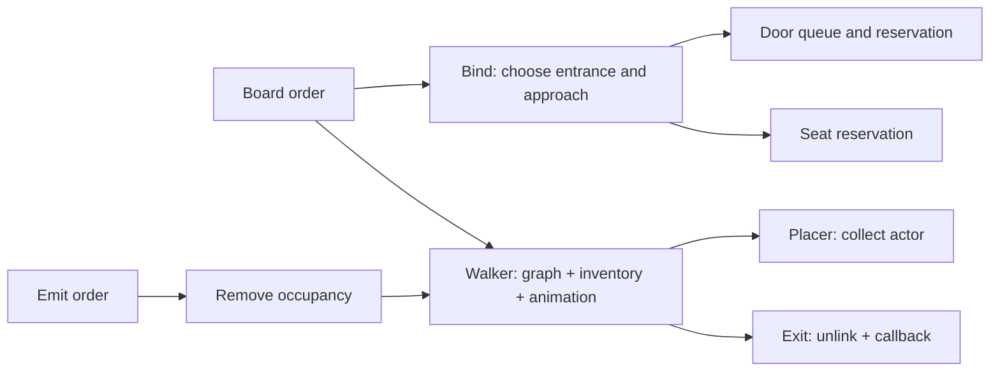

# Boarding, disembarking and the crew traversal graph — build 25492057

Static evidence only; addresses are RVAs. This pass connects the Board/Bind/Emit
orders to entrance selection, reservations, an entity-specific traversal graph,
animation/inventory transitions, crew collection and cleanup. It continues the
[placement map](placement-map-25492057.md). No game/editor execution or binary
modification occurred. Exported callers are discovery leads unless described
below; an entry inventory is not a claim of full semantic coverage.

## Separate states a replacement brain needs to read

An actor can be approaching a door, queued at that door, holding its reservation,
holding a seat reservation, traversing the boarding graph, or occupying a place.
These are separate structures. The Board order can finish without collecting an
actor, and Emit removes occupancy before the exit walker finishes.

Walker records are copied into another vector on each Quant and on actor
cancellation. Their addresses are not stable even when capacity would otherwise
be sufficient. Graph queries also overwrite routing scratch fields. Neither a
cached walker pointer nor a supposedly pure reachability call is a safe abstract
read interface without accounting for those effects.

## Order ownership and fields

RTTI identifies `Order::eBoard`, `Order::eEmit` and `Order::eBindForBoard`.
Primary game vtables are `10E84F8`, `10E8770`, `10E7F40`; editor equivalents
are `F4DA60`, `F4DCD8`, `F4D470`. Slot19 is the phase handler. The common
order owner at `+8` points to the actor's `+AF0` ordered interface, not its start.
Owner-relative `+2C8/+2D8/+2E8/+2F0` therefore refer to Fsm/Brain/Weaponry/Chassis.
Child order `+30` is ended through slot4 and deleted through slot0. Phase arguments
are 0=start, 1=tick, 2=end; normal results are 0=continue, 1=complete, 2=fail.

| Object | Fields |
|---|---|
| Board, size `1C0` | Target `+38`, target entity soft receiver `+58`; resolved root soft receiver `+E0/+E8`; chosen door name `+F0`; internal state int `+150`; requested place name `+158`; option byte `+1B8` |
| BindForBoard, size `1B0` | Base state int `+38`; target `+40`, entity `+60`; approach distance `+E8`; last actor XY `+EC/+F0`; cached target XY `+F4/+F8`; candidate XY vector `+100/+108/+110`; chosen index `+118`; retry count `+11C`; root soft receiver `+120/+128`; door-name vector `+130/+138/+140`, stride `60`; place name `+148`; option `+1A8` |
| Emit, size `68` | Retained OnExit object `+38`; actor-ID vector `+40/+48/+50`, signed shorts; selected slot short `+58`; mode int `+5C`; remaining count int `+60`; draining byte `+64` |

Factories `8E3B00/8E0300/8E5290` establish these sizes and arguments.
Board constructor variants initialize both soft receivers and two names.
Bind constructor `8E2A90` initializes its target, vectors, soft receiver and name;
the phase code establishes the other transient fields.

Board's selected parse/save wrappers `8E4BF0/8E4CF0` process only its target.
Bind wrappers `8E32F0/8E3830` process target plus place name. This is their
observed contract, not evidence that all transient fields are serialized elsewhere.
Emit `8E6440/8E6770` parses/saves a space-separated ID list, mode and count,
and optional named EmitTo object. The registry lookup is case-insensitive;
the constructed object receives virtual parse/save calls. Its concrete behavior
is still a separate dependency. Bare factory `8E5CE0` does not initialize all
mode/count fields before parser/binding work.

## Board phase handler

`8E3DB0` first requires a target, a concrete actor chassis (`+10` non-null),
and concrete target boarder/placer owners. If the actor is already a walker on
the canonical root boarder, it starts in internal state2 and waits for removal.
Otherwise it resolves a requested place with `77D0F0(...,availability=1,prefix=1)`
and checks `785E10`. A negative result fails.

`785E10` rejects invalid `-1` and self-boarding. Named ordinary slots must pass
availability; `NoCollect` slots bypass that test. Unnamed sentinel `-2` scans for
the first NoCollect slot or an ordinary slot that is enabled, unoccupied,
unreserved, unsealed and has its required bone. It does not perform pathfinding.

If already occupying a place (`77D070`, entity `+C0` ID), an unspecified request
completes. An explicit different request uses `77CEE0`, which swaps through
Exclude/Include, and can publish the place-swap command. Otherwise:

1. Clear chosen door, set order flag bit18, attach an initial BindForBoard with
   option0 and low order flags `5`.
2. On its successful completion, create a second BindForBoard using Board's
   option `+1B8`. Copy the selected door name and root receiver from that child.
3. Reserve the target place with `783310` and root door with `789C20`; set state1.
4. Wait while `7CCEB0` reports active inventory work. For actor targets, an
   access predicate `7FA7E0` must pass. `8E44E0` rejects a non-vehicle target
   containing a human occupant whose relationship to the boarding player is not
   ally (`2`), publishing notification code `12`.
5. The rejected permission/occupant paths return complete with bit18 set.
   Otherwise clear bit18, call `78C750` StartIn and enter state2.
6. State2 waits while `78D7E0` finds the actor in root walkers; absence completes,
   optionally invoking `AF7D50` for option `+1B8`.

Thus result1 alone does not mean successful occupancy. End phase drops FSM request
`157F470`, releases the root door and target seat reservation, and can publish
cancel command `15BAB0`. That phase does not directly call the walker-stop routine.
`7CCEB0` reaches inventory adapter `+28` and action-set `+80/+88`; the set's full
producer/cancellation semantics remain open. `7FA7E0` combines `7FA9D0` with
chassis slot36; a full permission interpretation requires those consumers.

## Approach and entrance selection

Bind initialization `8DEAB0` sets distance `+E8` to three times the sum of actor
and target radii; base start adds 200. It stores the canonical root entity in
`+120`. Invalid test `8DF890` rejects missing target/root or target `+38` bit9.

`8DE560` drops its child and advances the approach:

- Outside the squared approach radius: fail if the actor has not changed XY,
  otherwise remember both positions and create a move toward the target circle
  (state1).
- Inside: rebuild candidates through virtual slot23. No points means failure.
  Test near points through slot25, then use slot22 for the final approach (state4)
  or finish immediately if it returns no child.
- Otherwise probe the current position. A clear probe permits route selection
  through slot21 (state3) when the actor has moved. A blocked probe enters state2
  and allows up to 21 retries, gated by actor `+1C0` bit28, using obstacle helper
  `8F39A0`.

Base tick `8DE1F0` can replan when the target moves sufficiently while state1/3
is waiting on a child. The compared quantity is squared target displacement,
but the state1 threshold is the stored distance `+E8`, not its square; state3
uses 32. It also requires displacement greater than half the actor-to-target
squared distance. This is the literal comparison, not an inferred unit correction.

`8DF160` releases previous door queue/reservation and seat reservation, then
reserves a place and asks `789CB0` for reachable doors. For each door it samples
four radii using the pather parameter at `+20`: radii 0/1/2/3, with 1/3/5/7
angles covering a half-circle around the negative bone XY axis. The first clear
`8AC2B0` probe contributes a candidate XY. The viewed code does not establish
that the parallel name/point arrays remain one-to-one when every probe for a
door fails; that invariant needs producer/consumer verification.

`8DEB50` requests a `Pather::Task::ePoint` result for every candidate and chooses
the least-cost successful result (result stride `118`, cost `+18`, success
at `+110`). It queues the chosen door and creates route order `8F34F0(...,0)`.
`8DEDA0` tries capturing the door: failure produces a randomized .2–.7 wait.
If captured, planar coordinate differences beyond 1 trigger a final route;
otherwise a heading dot product below .9 creates a face-target child.
`8DF5D0` uses actor radius, generally plus32, for the near-point test.
`8DF790` ends its child and releases both door states and the seat reservation.

`789CB0` is specifically a door-load filter. It obtains graph-reachable root doors
and calculates `load = queue.size + (reservation != null)`. Let `m` be the minimum
load among those doors (initialized to 10000). It retains each door when
`load <= m + door.Queue`. This is relative balancing, not a hard capacity check.
`789B30` appends a raw actor pointer without duplicate suppression;
`789B80` removes only the first matching queue entry across all doors.
`789C20` reserves an unreserved door, or accepts the existing same-actor
reservation; `789C60` clears the first match. These are not soft receivers.

## Boarder definitions and runtime graph

RTTI identifies `Entity::eBoarder`, derived from `eResource/eReferenced`, size
`C8`, game vtable `10D82E8`, editor `F3A7E8`. Constructor `783050` sets vectors
empty, owner null, option0 and next walker ID0. Entity `+570` points to it; the
shared default at `156ED70` has no owner. Factory `789290` constructs a new object.
Clone `7891A0` copies base resource, node/link/animation definitions and door
records through container helpers; this is not a verified reset of every copied
door field. Destructor `783130/788F80` destroys seven vectors and base resource.

| Boarder offset | Representation |
|---|---|
| `+10/+18/+20` | Node definitions, stride `70` |
| `+28/+30/+38` | Link definitions, stride `188` |
| `+40/+48/+50` | Named animation definitions, stride `1B0` |
| `+58` | Owner entity |
| `+60/+68/+70` | Live walkers, stride `90` |
| `+78/+80/+88` | Saved walker records, stride `1C8` |
| `+90/+98/+A0` | Runtime graph nodes, stride `40` |
| `+A8/+B0/+B8` | Doors, stride `F8` |
| `+C0` | StartIn option, consumed/reset on successful collection |
| `+C4` | Post-incremented walker ID counter |

Parser `783AA0`, wrapper `7839C0`, registry `15729F0`, binds Node=`130`,
Place=`131`, Door=`132`, Attach=`133` to kinds 0/2/1/3 respectively. `785550`
finds unique node names; an existing name does not create another record.
Node definition: kind `+0`, name `+8` (size60), skip byte `+68`.
`7831A0` adds missing placer names to the definitions, choosing Attach only when
slot Attach bit9 and Entity resource string are both present; otherwise Place.

Link token `12F` creates four names: From `+0`, To `+60`, Anm `+C0`, Chain `+120`,
then forward/reverse action bytes `+180/+181`. `7854A0` resets an action byte and
sets PutOff bit0 (`13E`) or PutOn bit1 (`13D`).

Anm token `134` creates name `+0`, Forward `+60`, Reverse `+108`, each direction
size `A8`. `785220` binds Begin/Loop/End/Base (`137/138/139/13A`) to four
`28`-byte descriptors at direction `+0/+28/+50/+78`; Speed `13B` writes
`+A0` after multiplication by velocity scale `1547DB0`; fix_orientation/rotate
(`142/143`) set bits0/1 at `+A4`. `7853C0` reads descriptor string `+0`, optional
numeric animation argument `+20`, and LinkBegin=`1` / LinkEnd=`2` at `+24`.
The argument is forwarded to animation playback; its full playback meaning is
not established by the boarder parser alone.

| Door offset | Role |
|---|---|
| `+0` | Name, size60 |
| `+60` | Resolved bone; lookup fails when absent |
| `+68` | Raw reserved actor pointer |
| `+70` | Queue tolerance, default1; Queue with no numeric value uses INT_MAX |
| `+74` | Exit-selection cooldown deadline |
| `+78` | Chain name, size60 |
| `+D8` | Parsed auto_release_time, sentinel `1556DE8` means disabled |
| `+DC` | Last StartIn clock value for automatic release |
| `+E0/+E8/+F0` | Vector of raw queued actor pointers |

`78A040` rebinds door bones from owner skeleton `+B0` and rebuilds the canonical
graph, except when its phase argument is1. `78A600` follows parent entity links
while kind5 and the parent has a concrete boarder. It returns that root boarder.

Runtime node layout is slot ID short `+0`, kind int `+4`, bone `+8`, source
boarder `+10`, edge vector `+18/+20/+28`, routing predecessor `+30`, cost float
`+38`. Edges have stride78: destination index `+0`, direction-animation pointer
`+8`, PutOn/PutOff flags `+10`, Chain name `+18`.

Graph builder `78AE50` maps node definitions to runtime indices. It skips
definition byte `+68`; kinds0/1 require a named bone, while kinds2/3 resolve a
placer slot and retain its bone, possibly null. It recursively adds occupied
Attach slots' boarders to the same node vector. Links with unresolved endpoints
are omitted. Named animations resolve against the boarder's definitions;
missing/empty names use default `1572E20`, while literal `[fsm]` selects
`1572FD0`. The special-edge predicate `78ABB0` recognizes its forward/reverse
direction pointers `1573030/15730D8`.

Ordinary links get a forward edge; they get a reverse edge only when Chain's
string is empty. A link whose destination is Attach connects instead to each
Door node of that attached occupant's boarder, with the same reverse-edge rule.
These details allow the graph to cross an entity attachment hierarchy.

`78ABE0` snapshots non-null walker actors, cancels each (`78D620`), invokes
`9835B0(actor,0)`, destroys old graph edges, then recursively rebuilds.
`78A660` clears the current boarder's graph and rebuilds the canonical root.
Entity event handler `71A7C0` contains the attachment-change callers. Graph
rebuilding is consequently a behavior-changing operation, not a read refresh.

## Graph route and exit choice

`78B710` finds a node by door bone on the canonical root; `78B7A0` finds a node
by source boarder and slot ID. `78B7E0` immediately returns when source equals
destination; otherwise it clears all predecessor/cost scratch
fields, initializes the source cost, and processes a FIFO work deque. It visits
outgoing edges in reverse storage order, filters by an optional Chain, and
relaxes costs using `1 + 3D bone distance` when both bones exist (otherwise1).
It stops on the first destination removal from that deque and backtracks to the
first hop. This is not established as Dijkstra or globally shortest-path search.

`78BC50` uses that stateful search for non-vehicle owners. For owners with entity
type `+30` bit3, it accepts equality or a directly adjacent destination only.
The caller's boarder is material because both owner flags and graph base are read.

`78A230` selects an exit door reachable from a slot. Unless flags bit0 is set,
it requires no reservation, an expired/zero `+74` cooldown, and a clear
`8AC4E0` directional clearance probe. Flags bit2 selects the minimum squared
3D distance, preferring the slot bone position over the caller's fallback point;
without bit2 it retains the last accepted door in iteration order.
`78A150` sets the deadline for the first door reserved by an actor to
`now + duration_to_ticks(argument)`; the walker failure branch supplies `2 + U`.

## Live walker state and transitions

`78E460` StartIn resolves a door, timestamps automatic release when enabled,
finds its node and calls `78E5B0`. `78CC60` StartOut resolves the source slot
node and destination door node; it captures the door when automatic release is
disabled, then starts the walker with that door's Chain pointer and OnExit object.
It can publish a StartOut command. `78E500` is a corresponding node-to-door helper.

`78E5B0` links the actor to the root entity with link kind4, invokes optional
OnExit virtual slot3 before starting, creates a walker and immediately advances
it. Only still-active walkers are copied into the vector. OnExit uses reference
counting; the actor uses the entity soft-receiver chain.

| Walker offset | Role |
|---|---|
| `+0` | State int |
| `+8/+10` | Actor soft receiver and next pointer |
| `+18` | Saved actor `+DB4` bit17 selection flag |
| `+19` | Deferred orientation/transform flag |
| `+20/+28/+30` | From / next / final node pointers |
| `+38` | Current edge pointer |
| `+40` | Animation resource pointer |
| `+48` | Animation string, size20 |
| `+68/+6C` | Interpolation alpha / speed floats |
| `+70` | Inventory action ID, initial `-1` |
| `+78` | Optional pointer to door Chain name; not a copied name |
| `+80` | Walker ID |
| `+84` | State synchronization already sent byte |
| `+88` | Retained OnExit object |

`78EE10` advances through immediate transitions until the state stops changing.
An absent actor receiver returns inactive. The main states are:

| State | Work and next transition |
|---|---|
| 0 | Clear edge/animation/alpha/speed; find next hop and edge; apply initial link; prepare PutOff. No hop invokes Finish immediately. |
| 1 | Wait for local inventory completion, synchronize once if required, then request FSM transition before state2. |
| 2 | Switch FSM, play configured Base on the owner, process door event; begin animation goes to3, otherwise4. A vehicle chassis gate can skip to8 and set door cooldown. |
| 3 | Wait for Begin animation to stop, then4. |
| 4 | Set5, disable actor link transform following, start Loop movement/animation. |
| 5 | Interpolate toward next bone; on completion stop animation or drop FSM chain `walker`, update end link, then6. |
| 6 | Start End animation and enter7, or skip to8. |
| 7 | Wait for End animation, then8. |
| 8 | Switch to GetStateForQuit; set10; prepare PutOn, which can set9/12. If next is final, Finish occurs immediately even after that preparation. |
| 9 | Wait for local inventory completion, synchronize once, then10. |
| 10 | Finish if at target; otherwise advance From to Next, clear Next and restart0. |
| 11/12 | Remote inventory synchronization holders; no separate work case in this switch. |

`790920` implements PutOff/PutOn. Local PutOff can exchange a held item into
vehicle inventory when its definition tags match `drop_to_vehicle_when_board`;
otherwise it puts away the last item. Local PutOn takes the last item. Their
action IDs drive states1/9; remote branches use11/12. These calls have effects
and may outlive the current walker state.

`7911F0` applies link kind4 using from/next bone according to the descriptor's
LinkBegin/LinkEnd setting and transition phase, then sets link `+88` true.
`7915D0` selects Begin/Loop/End by state, copies its animation name, gets the
actor animation resource, copies direction Speed, and starts playback; Loop
uses flags `101`, other stages1. `791910` stops the selected animation.

`790400` interpolates only with both bones, distance at least `1e-5`, and positive
speed: `alpha += delta_ticks * speed / distance`, position using alpha capped1.
Normal fix_orientation uses the path direction to set the actor basis. Special
`[fsm]` edges limit yaw change by chassis slot25 times delta. Completion returns
false at alpha >=1. `792F70` handles the special edge by requesting movement
type `MT_NONE` when necessary, copying chassis `+34` speed, switching to `walk`,
and requesting FSM `move` under chain `walker`. Ordinary edges start configured
Loop playback when present or explicitly forced by load restoration.

## Finish, stop, Quant and saved walkers

Finish `791C10` branches by final node kind. A Door destination sets the human
FSM handler flag, restores pose, may take the last inventory item, releases the
door, calls the native-diagnostic `Linker::Drop` path `779420`, updates position,
emits actor event22 and invokes OnExit virtual slot4. This adds native descriptive
evidence for the entity `+560` link component; it is not a recovered RTTI name.

For a place/Attach destination it may first synchronize the owner's brain low
two `+398` bits with the boarding actor, gated by target actor `+DB4` bit8.
An ownership-byte change at actor `+DA8` invokes target actor slot58; changed
policy/player state causes brain slot19 notification `747`. The path unlinks
the walker actor, calls `785720` to collect its reserved place, releases the
door, may transfer selection, notifies the actor brain `407`, drops FSM request
`hold_back`, consumes boarder option `+C0`, and processes definition event `+EA`.
These are concrete writes/calls; full ownership policy and event effects remain
separate from this pass.

Cancellation `78D620` calls Stop `792830` for matching actor walkers, copies the
others into static scratch vector `15731B0`, swaps vectors and destroys the old
records. Stop cancels a non-`-1` inventory action, stops animation, unlinks the
actor, releases the root door and final-node boarder's seat reservation, and
switches to GetStateForQuit. It does not call Finish/collect/OnExit slot4.
Actor event handler `7F1AF0`, event `F`, calls it for link kind4; kinds2/3 use an
EmitInstant path instead. This establishes one outer cleanup route, not every
possible actor-destruction producer.

`78DE70` Quant first expires enabled door reservations using
`auto_release <= now - lastStart`, then advances walkers. Active walkers are
copied into **another** static vector `1573190`, swapped back, and old records
destroyed. Empty walkers cause owner notification `6FD4F0`. `71D020` invokes
Quant for concrete boarders, unless entity `+38` bit5 skips that entity's work.
Both scratch-vector paths need their scheduling context understood before any
assumption about concurrent direct calls.

Walker destructors `793CC0/789010` release OnExit, animation string and actor soft
receiver. The boarder vector destructor uses these resource destructors; they
do not themselves execute Stop's gameplay cleanup.

Save `7845C0` emits Walker records with actor short ID, nonzero state, selected
flag, From/Next/To node descriptions, Animating when speed is nonzero, Alpha,
optional OnExit, and ChainDoor when its pointer matches a door's Chain member.
Saved records have their own `1C8` layout and must not be cast to live walkers.
`78D810` resolves saved actor/nodes, assigns **new** walker IDs, reserves target
place nodes, reconstructs the current edge, binds the actor with kind4 and can
restart Loop/link state. Undefined edges generate a warning and skip insertion.
It destroys the consumed saved records afterward. `7936E0` resolves a saved
place through its entity's boarder; other node kinds use bone identity.

RTTI `eBoarderWalkerSyncCommand` binds encode `15B9D0`, decode/apply `15BA30`.
The payload stores entity identity, walker ID `+18` (4 bytes), and state `+1C`
(1 byte). Decode passes all three arguments to `78E070` (verified in assembly;
decompiled call omits the byte argument). It finds ID `+80` and assigns the
received byte to state `+0`, or logs missing ID. This closes the producer for
remote states11/12; it does not establish network reliability/order guarantees.
Editor receiver `60DDC0` additionally asserts
`_state > eWalkerState::NONE && _state < eWalkerState::COUNT`; its compiled
range is1–12, supporting NONE=0 and COUNT=13. Game receiver has no equivalent
range check. Editor encode `1025E0` also asserts that the entity is not Local.

GetStateForQuit `785F50` selects FSM name object `1572A10` for actor `+A38`
values4/5, or value3 with chassis movement type `+2C==1`; otherwise `1572A70`.
The mapping does not assume native names for those stance values.

## Emit: leaving a vehicle is not immediate completion

`8E55A0` requires a concrete boarder. Its airborne branch checks chassis slot55
with .25 and a placement/landing helper; when farther than1 above terrain it
requests `chassis/helicopter/RequestAltitude` and waits.

Mode3 disables weaponry at start and, during execution, writes **placer `+48=1`**.
Emit destructor `8E54A0/8E61F0` clears that byte for mode3 with an owner.
This resolves the blocked-readiness producer left open by the placement pass.
The store is reached through the adjusted owner interface, which is why a
literal search for `[entity+568]` alone did not locate it.

Picker `8E5A10` works on placer human slot IDs:

- Negative mode pops one actor short ID from the back of Emit's ID list and
  searches current occupants. A stale ID does not make this call continue through
  the whole remaining list; the caller can enter draining after that miss.
- Mode1 selects slots without registered-request bit12.
- Mode2 selects slots with bit12 **or** a nonempty Visor name.
- Other nonnegative modes include all occupied human slots.

`781230` supplies that request/visor predicate. A random index chooses among
eligible collected slots. These numeric modes are observed behavior, not a
recovered native enum spelling.

`7837F0` gets the optional OnExit position/flags through virtual slot5, invokes
`7849D0` (native diagnostic `EmitInstant`) and then StartOut. EmitInstant validates
the occupant, resolves an explicit or selected exit unless flags bit4 bypasses
that work, can publish a command, **removes occupancy through `77D420`**, applies
optional position/FSM changes and returns the actor/door. It is not a pure
exit-feasibility query.

After successful emission the order clears selected slot, decrements positive
count, and may enter draining. If the occupied-human vector is empty it can
return complete immediately. The distinct draining branch waits for the entire
boarder walker vector to empty. Otherwise successful emissions wait .2–.6,
failed emissions .1, draining polls .3–.9 (all via wait orders and context RNG).
Therefore occupancy-empty and exit-traversal-complete are different observations.

`78D0B0` also supports moving an occupant between places on entities sharing a
canonical root. It removes the source occupancy, reserves the destination,
starts a place-to-place walker, wraps the transition in source entity `+1C0`
bit21, emits event19 and can synchronize it. This is relevant to attached guns
and carriers as well as ordinary boarding.

## Evidence, comparison and remaining work

The paired game/editor Board, Bind and Emit phase handlers preserve the reviewed
states, field offsets, reservation/occupancy distinction and placer-block store.
Editor Board includes an additional diagnostic when initial requirements fail.
Selected parse/save wrappers likewise agree on their serialized fields. This
is a bounded contract comparison, not transitive equivalence of every helper.

Resource examples in `properties/car_crew.ext`, `tank_crew.ext`,
`cannon_crew.ext` bind doors to places with forward PutOff/reverse PutOn.
`properties/bicycle.ext` supplies a negative optional animation argument;
`properties/human_fsm/board.inc` declares the boarding/board/board_animation
states and their tags. Hashes accompany the manifest; no resource copies or raw
decompilation are committed.

The manifest records 112 game contracts/slices, 16 editor pairs and 101 fields.
Validation checks 18,299 instruction locations, ten RTTI tables, 70 byte
sequences and five resource hashes. Independent LLVM disassembly agrees on
10,133 instruction starts across 33 selected functions after normalizing separate
LOCK prefixes. These are structural checks; they do not prove ABI or live invariants.

Productive static leads remain: concrete EmitTo/OnExit objects and their flags;
StartIn/StartOut/move/cancel command receivers; raw reservation/queue cleanup on
every destruction path; node-definition skip-byte producer; full graph/animation
definition replacement lifetime; Board permissions and inventory action IDs;
path probe/result contracts and failed-door candidate alignment; ownership and
selection gates; skeleton-rebind phase/event producers; full save-load edge
failure recovery; chassis airborne/landing guards. The broader objective remains
active in [the static frontier](static-frontier-25492057.md).
