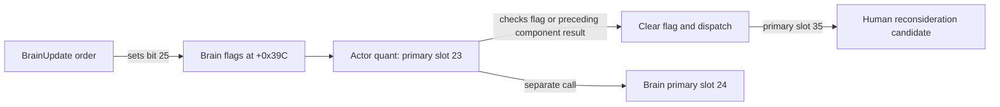

# Installed build 25492057 — initial static map

Analyzed on 2026-09-29. Build ID comes from the local Steam app 400750 manifest.
The executable hashes, rather than a guessed marketing version, identify this
analysis. Input files were read from the CrossOver Steam bottle without changes.

| Input | Size | SHA-256 |
|---|---:|---|
| `call_to_arms.exe` | 23,592,448 bytes | `4b6a807ad867c4f6eb1019376224d74fa3a6ac048355739ab0b76d73c7c0a267` |
| `call_to_arms_ed.exe` | 21,650,944 bytes | `3c6d7db86d530740d17945a212a4981bfa07307393d0cbb04b3d547a7cb44976` |

Both are x64 PE executables with preferred image base `0x140000000`. Both
contain a Lua 5.2.3 version string. Their embedded fixed file/product version
fields read `1.0.6.7`; this need not match the game's displayed version.

## Structural findings

The independent PE scanner found **84,991** unwind records in the game and
**65,426** in the editor. These counts are not exact function counts: records can
cover fragments, and leaf functions can have no record.

The RTTI survey validates a TypeDescriptor → Complete Object Locator → class
hierarchy → vtable relationship for each class below. The table lists **primary
vtable RVAs**, not hook addresses. Slots are zero-based.

| Class | Game vtable | Editor vtable | Consecutive executable pointers |
|---|---|---|---:|
| `eActor` | `0x10DE138` | `0xF417C8` | 68 |
| `Actor::eBrain` | `0x10EA0E0` | `0xF4F848` | 36 |
| `Actor::eHumanBrain` | `0x10EC7C8` | `0xF52068` | 37 |
| `Order::eBrainUpdate` | `0x10E6D40` | `0xF4C100` | 20 |
| `Order::eMoveToCover` | `0x10E6BD8` | `0xF4BF98` | 20 |
| `Helper::eCmd_actor_to_cover` | `0x1020F20` | `0xE96F28` | 18 |
| `Helper::eCmd_actor_state` | `0x10F3498` | `0xF59790` | 18 |

Both brain classes also have a secondary vtable at subobject displacement
`+0x10`, with four executable entries. Equal shapes make the editor a useful
comparison target; they do not prove equal behavior or addresses.

Comparing `eHumanBrain` against `eBrain`, and collecting the brain-update and
two command-class tables, yields **63 distinct candidate code RVAs per
executable**. Shared methods are deduplicated in the candidate TSV; the PE JSON
retains every class/slot relationship. No name in that TSV claims a recovered
function role.

## String anchors

| Exact string | Game RVA | Editor RVA |
|---|---|---|
| `actor_to_cover` | `0x1020FB0` | `0xE96FB8` |
| `actor_state` | `0x10F3528` | `0xF59820` |
| `advance_ratio` | `0x10ECAB0` | `0xF52388` |
| `retreat_ratio` | `0x10ECAC0` | `0xF52398` |
| `move_mode` | `0x10EA6A0` | `0xF4FE90` |
| `fire_mode` | `0x10EA690` | `0xF4FE80` |

The game contains exact `BotApi`, `CaptureFlag`, `SeekAndDestroy`, `QueryScene`,
`GetVar`, and `SetVar` strings; this scan found none of those exact strings in
the editor. This is evidence of a difference in the two scripting surfaces,
not proof that every related capability is absent from the editor.

## Ghidra investigation

The focused exporter follows candidate entries plus code references to the
listed strings and relevant vtables. It records exact-entry checks, incoming
references, direct/indirect calls, and decompilation outcomes. Ghidra's inferred
prototypes remain provisional. Local decompiled code is kept outside Git.

Ghidra 12.1.4 completed and saved both programs: 541 seconds of autoanalysis
for the editor, 651 for the game. It recognized 72,355 functions in the game
and 69,039 in the editor; those are analyzer counts, not ground truth.
**All 63 initial candidates per executable were exact Ghidra function entries.**
The first exports decompiled 79 game and 78 editor functions, including anchor
referrers, with further caller/dispatch exports captured separately. The
[validation manifest](../artifacts/build-25492057/ghidra-validation.json) records
counts, RVAs, binary hashes, and hashes of the local export reports.

All requested focused decompilations completed. Automatic analysis emitted
nonfatal demangler/data warnings, and decompiled bodies include inferred-type
and unresolved-indirect-jump warnings. The reviewed control flow below was
checked against assembly rather than relying on inferred C prototypes.

## First behavioral map

Disassembly review, independently cross-checked with Apple's LLVM 21 objdump,
connects the actor update path to a specific human-brain virtual method. These
are proposed role names, not recovered source symbols or verified hook APIs.

| Proposed role | Game RVA | Editor RVA | Evidence |
|---|---|---|---|
| Actor quant/update dispatcher | `0x7EFD10` | `0x671DF0` | `eActor` primary slot 23; profiler labels `scene:quant:actor:bup` and `buq` |
| Clear pending flag, dispatch brain update | `0x9035C0` | `0x789B40` | Clears bit 25 at brain `+0x39C`, then tail-calls primary vtable slot 35 |
| Human reconsideration candidate | `0x941D00` | `0x7C9290` | `eHumanBrain` slot 35; game body uses advance/retreat ratio fields |
| Brain-update order action | `0x8CEDC0` | `0x754EE0` | `eBrainUpdate` slot 19 sets bit 25 when its second argument is zero |
| Human named-property binding | `0x9426E0` | `0x7C9D10` | Secondary vtable slot 2 binds ratio strings to member addresses |

The observed path is:

The actor dispatcher reads a brain pointer at **actor `+0xDC8`**. In the game,
its call at `0x7EFEA7` enters `0x9035C0`, whose virtual tail-call reaches
`0x941D00` for a human brain. The corresponding editor call is at `0x671F93`.
The order action reaches the same brain pointer through an actor subobject:
`order+8` contains the `eOrdered` view at actor `+0xAF0`; its `+0x2D8` is actor
`+0xDC8`. Slot 16 of that order performs a dynamic cast to RTTI type `eActor`
and the `+0xAF0` adjustment, providing independent support for the relationship.

This identifies a much narrower candidate for future decision replacement
than the inherited `AI_UPDATE` label. It also shows why replacing the entire
actor quant would be premature: it visits other components and has a separate
brain slot-24 call. The conditions on the preceding component, the exact
purpose of slot 24, and every side effect of slot 35 remain to be mapped.

### Named fields and the secondary-this adjustment

| Property | Offset from complete `eHumanBrain` | Property visitor's local displacement |
|---|---|---|
| `advance_ratio` | `+0x524` (float) | `+0x514` |
| `retreat_ratio` | `+0x528` (float) | `+0x518` |

The property-binding routine receives a pointer to the **secondary subobject
at `+0x10`**, not the complete brain. Forgetting that adjustment would put both
fields 16 bytes too early. Both executables show the same binding relationship.
The game's human constructor at `0x9417E0` independently installs the two
vtables at `+0`/`+0x10` and initializes complete-object fields `+0x524`/`+0x528`
to `2.0f`; those are constructor defaults, not necessarily final gameplay
values after configuration is applied.

The game binds `advance_ratio` at instruction `0x94299F` and `retreat_ratio`
at `0x942A4B`; editor equivalents are `0x7C9FCF` and `0x7CA07B`. The human
slot-35 implementation accesses the complete-object fields in its arithmetic.
This establishes the name-to-field connection statically without running GEM.

One negative result is also useful: human primary slot 6 (`0x9424E0` in the
game) is an empty return. The command class contains string-formatting and
serialization methods as well as action paths. Neither a class name nor a
vtable entry alone establishes an AI execution hook.

The machine-readable summary is [reviewed-map.json](../artifacts/build-25492057/reviewed-map.json).
No structure definition or runtime offset table has been changed to consume
these findings.

### Cover action path

The game command's primary slot 16 (`0x19D0E0`) contains a path which calls
`0x8CD320` at `0x19D22A`, then passes the returned object to actor routine
`0x7EFA10` at `0x19D23C`. The factory allocates `0xD0` bytes and installs the
RTTI-identified **`Order::eMoveToCover`** vtable `0x10E6BD8`, copying a cover
descriptor into the object. This connects a named GEM command to a native order
object without running the editor.

The submission routine's decompilation and diagnostic string support an
add-order role: on the accepted path it calls brain primary slot 18 with the
order; on rejection it calls virtual cleanup/destruction on that order and
returns null. This is evidence of a lifetime contract that must be preserved,
not a declaration that callers should manually free every submitted order.
The full ownership contract, cover descriptor members, and other command
branches are still unresolved. These two callees are
in the game follow-up TSV. They are promising action interfaces for a custom
brain, but not yet callable declarations.

Next static work: review the human slot-35 state transitions; identify the
perception/target inputs it reads; finish the order submission contract and
`actor_state` path; then recover only the engine interfaces needed for the
first replacement decision loop. Accuracy control remains a separate pending
weapon/aiming investigation.

## Validation and remaining limits

- Six synthetic PE tests cover RVA/file-offset separation, truncated or
  unbacked reads, unwind boundaries, RTTI self-reference rejection, vtable
  recovery, and exact-string matching.
- Both installed executables successfully pass the structural survey.
- No runtime hooks have been installed or tested; object ownership, callback
  timing, thread affinity, and callable ABI are still open.
- There is no verified complete world/actor layout, replacement AI scheduler,
  or accuracy-control API yet.

Artifacts: [`call_to_arms.pe.json`](../artifacts/build-25492057/call_to_arms.pe.json),
[`call_to_arms_ed.pe.json`](../artifacts/build-25492057/call_to_arms_ed.pe.json).
