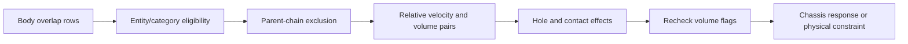

# Entity collision policy, volume queries and physical-response boundaries

Build `25492057`; static evidence only. Addresses/offsets are hexadecimal and
virtual slots decimal. This pass reviews46 paired contracts,57 fields,12 RTTI
tables and10,110 instruction starts independently decoded with LLVM. The map is
[entity-contact-map.json](../artifacts/build-25492057/entity-contact-map.json).
Several outer contracts deliberately stop at named physics, geometry, interaction
or networking helpers; those are continuing static leads.

## Named collider policy

Entity `588` points into a global vector of`88`-byte collider profiles.
`724250 / 59F1C0` loads `/set/colliders.set`; `724A70 / 59F9C0` looks up a name
and `724A20 / 59F970` returns the first profile as the default. Entity parser
`72AEA0 / 5A5CB0`, case`A4` (`Collider`), assigns that pointer, diagnosing a
missing name and then using the default. This joins previously anonymous masks
to authored behavior:

| Profile offset | Property | Established effect |
|---|---|---|
| `60` | `RejectColliderByVolume` | Declaration clears the default1 byte; complete consumer still open |
| `61` | `PointCollider` | Enables the selected entity's sampled-vertex response path |
| `62` | `NoCollideForStable` | Eligibility requires active simulation or this flag clear |
| `63` | `NoContactsAtAll` | Suppresses this side's physical response |
| `64` | `CanPush` | Category mask plus actor-state/diplomacy tests |
| `68` | `CanPushBroken` | Category mask plus target actor's `destroyed` tag |
| `6C` | `UseRamVolume` | Sets temporary contact-state bit5 for eligible ignored directions |
| `70` | `NoContactWith` | Category mask suppressing this side's response |
| `74` | `CollideWith` | Category mask for outer overlap/contact eligibility |
| `78` | `ColliderId` | Signed category index; default−1 |
| `79`, `7C`, `80` | `Blocking`, `Speed`, `Penetration` | Low-speed/shallow-penetration blocking policy |

Masks are32 bits. `725160 / 5A01C0` supports additions, `-tag` removal and an
initial bare `clear`. Both addition and removal intern missing category names.
The category registry initializes once; profile reload does not itself clear it.
Profiles inherit payload fields from an already inserted named row while keeping
their own name. Ordinary mask declarations add to inherited masks.

[collider-profiles.json](../artifacts/build-25492057/collider-profiles.json)
resolves the41 profiles and30 categories in the installed base member. Its
numeric category model explicitly assumes an initially empty registry. The
bounded script rejects unfamiliar forms and does not resolve mounts or entity
attachment. The first/default profile is `nothing`.

Profile names are not category names. `vehicle` has `ColliderId "nothing"`;
`marine` uses `armored`; `airborne` uses `tank.heavy`. Five mask categories have
no direct `ColliderId` assignment in this file: `vehicle`, `mine.ap.grenade`,
`ammo`, `marine` and `marine.heavy`. That does not prove those bits are unused
under other mounted definitions.

The `human` profile illustrates the distinction between detection and response:
it detects `bush`, `mine.ap` and `mine.ap.grenade`, while `NoContactsAtAll`
suppresses its physical-response side. Volume interactions can still run.
`vehicle` enables `Blocking` with authored Speed10 and Penetration0.2; `cannon`
inherits it but changes those to20 and0.3. Consumers multiply the two values by
`1547DAC` and `14776C0`, respectively; these globals are not treated as observed
runtime constants.

## From overlap to response

`9843C0 / 80CE30` excludes an ancestor/descendant pair by walking each entity's
`560->8` parent chain. It does not reject siblings just because they share a
parent, and it does not begin with a self-equality test. The hierarchy's validity
is an owning-system precondition.

`727410 / 5A22A0` produces each direction's response-suppression flag. Besides
the named properties, it respects locality. `CanPush` also checks target actor
`DB4` bit8 and diplomacy result1; `CanPushBroken` specifically checks the actor's
runtime `destroyed` tag, rather than directly reading health.

`727D60 / 5A2BE0` obtains effective velocities, computes B−A, and enters the
volume phase when any absolute component exceeds`1e-5` or the relevant chassis
flags require processing. Entity virtual slot47 normally returns zero; actors
return chassis `20/24/28`. Entity `1C0` bit28 follows the parent's effective
velocity instead. Simulating entities read body velocity through
`737C60 -> 73DD70`, at simulator`558+8`, body`48/4C/50`.

It derives enclosing spheres from each entity's `5A8` world box. Assembly supplies
this missing decompiler argument. It collects enabled bit9 hole volumes near the
other sphere, then tests enabled volume pairs with bit3 or bit5. Volume state
`28` bit5 means disabled here. The lower intersection refreshes both transforms
and returns a witness point, direction and separation/penetration scalar.

`728830 / 5A35F0` first handles hole coverage. For an eligible bit10 volume it
samples the opposing volume and requires every sample to lie in at least one
candidate hole. Samples may be covered by different holes. The stored hole is
the last containing hole for the last sample, not proof that one hole contains
the whole shape. With a nonempty hole list, an empty sample list passes this loop
vacuously. Successful coverage emits `in_hole`.

Bit3 volumes run volume-contact events before physical response. `7955E0 /
615940` marks current contact, dispatches definition event`E6` when prior contact
was clear, and queues the owner once through `508 / 798B10`. Entity slot35
event`14` can also receive both volume pointers. Reset/drain and reentrant
callback behavior remain open.

Both volumes must still have physical bit5 for response. Actor/human attachment,
chassis, simulation and diplomacy checks add exclusions. The code runs
`contact_effect` in each permitted direction, then **checks the volume flags
again**. An interaction can therefore change whether physics follows. Context
contains the two entities, current volume, contact point, opposite normal
directions and relative normal velocity; throwable stuff can change source
attribution. Definition event`E4` also participates.

If the geometry remains eligible, the code compares relative normal velocity,
penetration and the direction between entity positions. `729870 / 5A4600` can
instead set chassis`3C0` bit10 for a nonstationary actor below its configured
speed and penetration thresholds. This branch requires its response direction
to be enabled and runs only when neither side is already simulating or has the
special active chassis flags. The bit10 consumer is still a lead.

Response selection keeps sides whose suppression flag is clear and which either
have the relevant chassis kind or can activate simulation. `726B00 / 5A1990`
establishes activation flags, entity event`D` and eligible network
`SimulationCommand` kind`28`; deeper networking reception remains open.

## Physical handoff and cleanup

`729070 / 5A3E00` chooses the first selected `PointCollider` side and tests its
sampled vertices against the opposing volume, optionally substituting a hole
and reversing the test. Accepted points moving into the surface call chassis
slot23 with opposite normals for the two sides. A simulating side also hands the contact data to `733690`, followed by
`733EC0`; their internal processing and cleanup roles remain open.

`7295D0 / 5A4360` provides the whole-pair fallback with the same chassis/constraint
boundary. Constraint depth has an upper cap of`0.5 * 14776C0`. Material helpers
`7300D0 / 730100` choose the larger`98` and smaller`9C` coefficients; their property
names and units are not yet established. The actual solver remains open.

After response or an effect-induced volume change, each entity accumulates the
other's `A2C+A30` into `A34`; the producers and precise meaning remain unknown.
A changed volume can invoke `slow_on_crush`, sending the other actor's chassis
slot59 request`29`. Both direction indices are confirmed in assembly. At the end
of the active contact phase the code clears the entire optional `1C8->0C` word
on both entities, including the temporary ram-volume bit.

Simulator coupling `726F20 / 5A1DB0` appends a SoftLinkable receiver to entity
`A68`. It does not add an owning entity retain or check for duplicate links.
Full removal and callback ordering remain lifetime leads.

## Trace geometry and obstacle updates

The shape at entity-volume`50` uses **TraceVolume** classes. Its slot4 performs
point projection/classification; slot5 enumerates samples. This interface is
distinct from the `eBoundingVolume` classes used by spatial areas.

`795890 / 615BE0` refreshes a volume when its cached word`8` differs from the
bone's `1EC` revision, storing the revision before recalculation. `795AF0 /
615E60` composes the definition's local matrix with the bone and computes an
inverse. Volume`58..B7` therefore contains96 bytes: forward plus inverse affine
matrices. State bit6 adds a global displacement before composition; those global
producers still need interpretation.

The sample producers now have concrete contracts:

- Box: eight transformed corners from the three half-extents.
- Cylinder: twenty samples, paired top/bottom at ten angular positions.
- Polyhedron: every stored vertex, transformed into world coordinates after the
  still-open capacity/reset helper`5F6140`.
- Sphere: transformed cached unit samples, selecting the larger cache only when
  radius exceeds`0.5 * 14776C0`. Cache constructors/generation remain open.

Point queries return a world surface point, normalized direction and signed
distance. Sphere uses a`1e-4` local radial floor and excludes its exact boundary.
Box uses a`1e-5` tolerance and chooses the positive face on an equal-side tie,
then X before Y before Z on axis ties. Cylinder has strict radial but closed
axial containment and a zero-sign deadband in its cap calculation. Polyhedron
keeps the closest absolute signed face result, traversing faces in reverse; its
distance remains in local units even though the point and direction are world
values. The face helper and degenerate-input contracts remain open.

The native pair wrapper `5F62A0 / 467FC0` prepares two `DT_Transform` objects,
sets tolerance globals and calls `5F81F0`. Success fills the witness result;
failure leaves it untouched. The lower support/solver algorithms are continuing
static work.

`71F560 / 59A440` now maps procedural refresh: compound obstacles are rebuilt,
while a single procedural obstacle can replace its first shape or become
disabled for an empty point cloud. `720070 / 59AF70` registers pather shapes only
on a requested transition of entity`1C0` bit14. Disabling unregisters and deletes
the zone's`C8` clone; enabling creates eligible missing clones and copied entity
contexts. An unchanged mode does not itself rescan every changed zone.

## Terrain-height sampling recovered from assembly

`704380 / 57E110` returns float zero without a heightmap, otherwise calls layer0
of `A3E8D0 / 8C6FC0`. Ghidra emits an empty void function for that helper, but
the complete assembly computes and returns a bilinear height in`XMM0`.

The helper adds XY offsets, converts each coordinate to an integer with
truncation toward zero, then uses signed integer division by cell spacing. It
clamps the four sample indices, reads signed16-bit heights from four-byte cells,
and interpolates. Fractions use the original, unclamped cell indices and float
coordinates. This is not floor-based indexing or fully clamped interpolation;
it can extrapolate near a low edge where a negative coordinate truncates to
index0. Layer construction, units and reachable query ranges remain open.

Validation checks fingerprints, entries, RTTI, property registration bytes,
constants, resource identity and instruction addresses. LLVM agrees after LOCK
normalization. These checks do not prove semantic interpretations, callback
safety or runtime reachability. The
[continuing frontier](static-frontier-25492057.md) retains the unresolved work.
