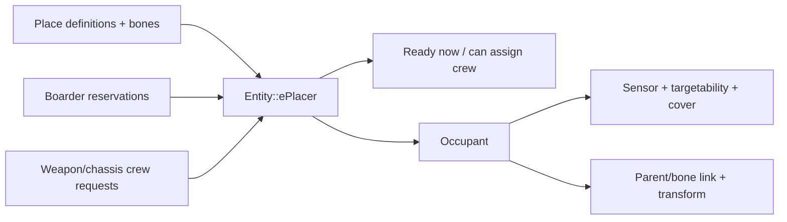

# Crew placement, readiness and linked entities — build 25492057

Static evidence only; addresses are RVAs. This pass follows the weapon readiness
gate into `Entity::ePlacer`, crew assignment, boarding reservations, occupant
visibility/targetability and the separate entity link component. Exported callers
are discovery leads unless explicitly described here. No game/editor execution or
binary modification occurred.

## What the AI actually needs to distinguish

A vehicle has several related states: configured places, occupied places,
reserved places, crew requests and physical entity links. They are separate
structures. An occupied place may be sealed, have no exposed bone, disable its
occupant's sensor, or make that occupant ineligible as a target. A request can
move crew between places in the same group.

The assignment feasibility routine is not a pure query: it uses temporary slot
flags, and some early exits bypass normal cleanup. Readiness and feasibility must
not be substituted for one another in a replacement decision layer.

## Ownership and concrete type

Game `eGameEntity` constructor `719520` sets `+568` to default placer `156ED00`.
`71A040` allocates `0x70` bytes, invokes `77AD40`, stores the pointer at `+568`
and binds placer `+40` to the entity. The constructor installs RTTI-backed
`Entity::ePlacer` primary vtable `10D7F38` (editor `F3A3D8`), derived from
`eResource/eReferenced`. Parser `72AEA0`, case `A9`, creates a concrete placer
when its owner is null and dispatches resource parsing. This is a parser slice,
not an entity initialization function.

`72AA90` clones a non-default source placer through `E83F0(...,2)` and rebinds
its owner. `780EC0` copies base resource data, slot definitions through `780880`,
and Crew byte `+49`. Slot cloning starts with newly constructed records, then
copies six names, flags, cover kind and entity resource path. It does not copy
resolved bones, live occupant receivers, reserved pointers or entity IDs into
those new records. Copied flags still include runtime flag values; do not equate
this operation with a blanket reset of every runtime state.

Entity destructor `7198F0` releases a concrete placer through reference count
`+8` and lifetime flags `+C`, then restores the default pointer. Placer destruction
`77ADD0/780BB0` destroys slot receivers/names/strings and its vectors. The entity
owner pointer alone is not a lifetime guarantee for an independently cached read.

| Placer offset | Representation and role |
|---|---|
| `+10/+18/+20` | Vector of signed 16-bit occupied **human** slot IDs |
| `+28/+30/+38` | Slot vector, stride `298` |
| `+40` | Owner entity |
| `+48` | Readiness/request blocking byte; zero at construction, live producer still open |
| `+49` | `Crew` bool; false bypasses crew requirements |
| `+4A` | Parsed `Sealed` load marker |
| `+50/+58/+60` | Active request vector, stride `348` |
| `+68` | Next request ID, initialized zero and incremented by `781370` |

## Slot layout and named configuration

Six name objects are `0x60` bytes each: name at `+0`, Group `+60`, Visor `+C0`,
LinkBone `+120`, HandleBone `+180`, Pose `+1E0`. Each embeds a string at relative
`+40`, length `+50`, capacity `+58`. Consequently slot `+110/+170/+1D0/+230`
are name string lengths, **not four pointers**. This matters in donor selection
and missing-bone tests.

| Slot offset | Role |
|---|---|
| `+240` | Resolved link bone pointer |
| `+248` | 32-bit flags below |
| `+24C` | Attach cover-kind integer, parsed by `8A9720` |
| `+250` | Occupant entity ID; initialized/reset to `-1` |
| `+258` | Configured Entity resource string, length `+268`, capacity `+270` |
| `+280/+288` | Occupant soft receiver: pointer and next receiver in entity chain |
| `+290` | Reserved entity raw pointer; independent of the occupant receiver |

`77A690` constructs a slot; `77A730` copies definition fields; `780570`
detaches the soft receiver before destroying strings/names. Native diagnostics
identify setter `77A830` as `ePlace::SetReserved`.

Parser `77DCB0`, registry `1572030`, and editor parser `5FC8B0` bind the following
bits. Token IDs are scoped to this registry, not global event numbers.

| Bit | Binding / established role |
|---|---|
| 0 | TurnOff.Sensor (`AA/AB`) |
| 1 | TurnOff.Shadow (`AA/AC`) |
| 2 | TurnOff.Visible (`AA/AD`) |
| 3 | TurnOff.Targetable (`AA/AE`) |
| 4 | State.Disable (`B5`) |
| 5 | State.Unlinked (`B0`) |
| 6 | Flexible (`BA`); optional argument also binds HandleBone |
| 7–8 | Obstacle (`B2`): Auto=`00`, Enable=`10`, Disable=`01`, External=`11` (bit8 then bit7) |
| 9 | Attach (`B1`); Entity (`AF`) in a Place definition also sets it |
| 10 | UseVision (`B8`) |
| 11 | OpenForCrush (`C1`) |
| 12 | Place named by a registered crew request, set by `781370` |
| 13 | Temporary assignment mark used by `782310/7826A0` |
| 14 | NoCollectWhenSpawn (`BC`) |
| 15 | NoCollect (`BD`) |
| 16 | Stealth (`BE`); downstream behavior not completed here |
| 17 | StoredTouch (`C4`), also saves a collision volume's previous touch flag |
| 18 | Request-controlled entity policy (`781C00`), native policy name still open |
| 19 | Sealable (`C2`) |
| 20 | Current sealed state (`77B4E0/77D6B0`), serialized as Sealed (`C3`) |

Place (`A4`) finds/creates by name; Remove (`BF`) erases a matching record.
State (`A5`) requires an already declared place. LinkBone/HandleBone/Group/Visor/
Pose are `A6/A7/A8/B7/C0`. Crew (`BB`) writes placer `+49`; Sealed (`C3`) sets
`+4A`. State.Broken (`A9`) skips/reads a structure here; this parser alone does
not establish a new broken-state field. Worker (`B9`) exists in registration but
has no separate case in this parser.

Resource evidence agrees: `properties/vehicle.ext` enables `{placer {crew}}`;
`properties/tank_crew.ext` defines grouped crew places, visible crew with link
bones and TurnOff.Sensor, and a Sealable place with visor `top`. These examples
support the bindings; they are not a census of every entity definition.

## Sealing and crew exposure

`77B4E0(placer,bool)` changes bit20 for each currently sealed slot, or each slot
that is Sealable, has a resolved bone and is occupied. It collects the affected
slots and then invokes `77B620` on each. It does not first skip unchanged values;
callers must not assume this is an idempotent raw boolean setter. Initialization
`77D6B0` binds bones, creates/collects configured entities, and applies the parsed
Sealed load marker using the same eligibility rule. Serializer `77E590` emits
Sealed if any slot has bit20; editor `5FD230` confirms this condition.

For an occupied sealed slot, `77B620` first tries moving the occupant to an empty
slot with the same Group, no Disable flag, no reservation, no sealing and **no
resolved bone**. A required-but-missing LinkBone also disqualifies the destination.
It uses Exclude/Include, not a pointer swap. If no relocation occurs and the
original slot has a bone, it:

- Updates the named owner sensor visor's active count `+60` and, for UseVision,
  the supplied occupant vision through `890870`.
- Sets occupant entity `+38` bit9 from the sealed state using `6FD200`; that
  setter notifies entity virtual slot40 (`+140`) only on a change.
- Emits occupant event `1E/1F`, or `23/24` for Attach, on unseal/seal respectively.
- Sets occupant link component `+88` to `!sealed`, enabling/disabling transform
  following independently of the stored parent pointer.

`806550`, in the weaponry activation path, scans weapon place tags `+5E0/+5E8`;
if any named slot is sealed, it calls `77B4E0(false)` before feasibility/crew
request processing. This is a concrete AI-to-crew exposure dependency.

## Include, Exclude and the perception connection

`77C140` Include rejects an already occupied slot, appends its ID to the human
slot vector if entity type `+30` bit2 is set, assigns the soft receiver, copies
entity ID `+C0` to slot `+250`, and clears the separate reservation. It manages
the named owner visor count and optional UseVision source.

With no resolved bone, it sets entity `+38` bit9 and links the occupant to the
owner root bone with link kind3 (the native log calls this INACTIVE). With a bone,
it clears that bit and uses kind2 or kind5 for Attach (logged ACTIVE). Flexible
places can adjust bone transforms first. Further effects depend on slot flags:

- OpenForCrush sets occupant `+1C0` bit23.
- TurnOff.Visible clears entity `+38` bit6 and notifies virtual slot13.
- **TurnOff.Targetable clears actor brain `+398` bit15.** This is the producer
  missing from the earlier target map: `878560` uses that brain flag in the
  relation1 actor target eligibility bit. Assembly store is at `77CAE3`.
- TurnOff.Sensor writes actor sensor `+18=1` and invokes sensor slot11.
- TurnOff.Shadow changes matching skeleton resources' bit3 and descendant state;
  the full rendering consumer remains separate.
- Bit18 reapplies the entity policy through `7829F0`.
- Attach cover kind and a resolved bone can register actor cover through `898AD0`.
  A matching owner collision volume is found by name/tag (`77DAE0`); its touch
  bit11 is disabled and the old state remembered in slot bit17.
- A Pose name requests the corresponding animation. Entity/owner placement events
  and scene `cmCP_UpdateStates` (`104D`) propagate the result.

`77B950` Exclude removes the human slot ID and visor contribution, restores
visibility/targetability/sensor state, clears OpenForCrush, removes cover, restores
the saved volume touch bit, unlinks the soft receiver, resets ID to `-1` and clears
reservation. These are explicit set/clear operations; they do not save arbitrary
preexisting visibility or targetability policy. If sealed, Exclude temporarily
clears bit20, applies unseal side effects, then restores the bit before removal.

`77D420` emits an occupant immediately: Exclude, clear entity bit9, unlink its
physical link, notify owner event19, clear the slot sealed bit, return the old
occupant. Exclude by itself and physical unlink are distinct operations.

`781C00` sets bit18 over a request's named slots. Occupied slots with bones get
entity `+38` bits25–26 set to 2 when enabled, or restored via entity slot39 when
disabled, and entity byte `+149` set to `1` or `FF`. `7829F0` applies the same
policy to a single newly included occupant. A native name for this policy has
not yet been established.

## Request registration, readiness and assignment

Request definition: tag-set tail `+318/+320/+328` is a vector of names, `+330`
priority, `+334` ID, `+338` required count. Runtime records have stride `348`
and append `+340` protection option and `+341` latest success. Registration
`781370` marks named slots bit12, assigns a monotonically incrementing placer ID,
and sets priority. Place setup `8103C0` registers its three requests at
`+2C8/+608/+948` with priorities `3/2/4`. Chassis setup `83F420/83FA80` registers
its request at `+80` with priority1. These priorities are numeric facts; request
role names need the respective property parser bindings.

`781D50` is **ready now**: Crew false succeeds, blocking byte true fails;
otherwise it counts requested named slots that have an occupant and are unsealed,
returning true as soon as the required count is reached. There is no separate
up-front required-zero success path.

`781F60` is **can become ready**: it uses that same initial count, then runs
assignment `782310` and compares the number of returned pairs with required
count. It does not move occupants, but the planner does mutate slot flags.
`781410` creates/updates the active record by ID, sets `+340=(argument==0)`, works
every active request in vector order and returns that request's `+341`.
`7815F0` removes by ID, compacts the request vector and reworks the remaining
requests. It does not clear registration bit12 from the slot definitions.

Planner `782310` produces `pair<int16 destination,int16 source>` records:

1. Visit all requested slots. A missing name, Disable, missing required bone,
   nonnull reservation or sealing returns early. Occupied eligible slots append
   a self-pair and get temporary bit13.
2. Revisit requested empty slots and ask `7826A0` for a donor. Mark the donor
   bit13 and append its pair; no donor breaks this pass.
3. On the normal exit path, clear bit13 on each pair's source.

Early validation exits branch past the cleanup loop (`782665` versus loop at
`78260F`), so a prefix of self-pairs/marks can survive a later invalid requested
slot. Do not infer all exits undo temporary state.

Donor choice is ordered, not a global optimum. It scans the human occupied-slot
IDs and matches Group. First it accepts a donor lacking request bit12 and a Visor
name. This first path has **no bit13 test**. If no such donor exists and the
required count has not already been fulfilled, a second pass considers requested
or visor-bearing places, rejects bit13, and protects an already-successful active
request when that request has `+340` set or priority `<= incoming priority`.
These exact conditions should not be strengthened into unproved invariants.

`782100` stores success as pair-count >= required. On the applicable local
execution path, successful non-self pairs move an actor using Exclude/Include,
optionally issue `ePlacerMoveCommand`, and notify owner event19 if moved. Request
success therefore records a plan/count result, not proof that every conceivable
occupant type or remote path has already performed a physical move.

## Boarding reservations and slot queries

`77D2F0/77D240` return the first exact-name slot pointer/ID. `77D0F0` adds optional
availability filtering and prefix matching. Sentinel shorts at `1480730/1480734`
are `-1/-2`: rejected/not-found and unspecified-name eligible-place case. A
nonempty unmatched name returns `-1`; an empty name with an eligible place returns
`-2`. Predicate `789160` checks Disable, required bone, no occupant, no reservation
and no sealing; its boolean result is AL despite Ghidra's larger integer return.

Boarder `783310` captures a place for an entity, using prefix resolution and
availability. NoCollect slots are a special accepted branch; normal slots get
raw reservation `+290=entity` and owner event19. `785660` captures a supplied ID;
`7835F0` clears the first reservation matching an entity. `785860`, named
PickReservedPlace by diagnostics, finds the matching reservation if enabled and
its required bone exists; it can also select a NoCollect slot without a matching
reservation. It does not repeat every general-availability test.

`785720` collects into a valid reserved place through `77D360`, or clears a stale
matching reservation and notifies. `77D360` Includes when NoCollect is clear;
otherwise it only clears the reservation. `78C750` StartIn handles lookup failure
by clearing the reservation, handles NoCollect specially, and starts the boarder
walker/network command path. The full walker/order cancellation and actor-death
paths remain a follow-up: a raw reservation is not automatically the same kind
of lifetime-managed reference as the occupant.

Bone binding `77E9F0` looks up LinkBone on owner `+B0`. Flexible missing bones
can be created as `_placer_flexible_%1%`, parented under HandleBone or the root.
`77B040` resolves saved ID or spawns configured Entity resources when not Unlinked,
then collects unless NoCollectWhenSpawn/NoCollect says otherwise. It increments
the named visor expected count `+62` and may emit `ePlacerSlotIdCommand` for a
newly spawned entity. Complete spawn/definition ownership is not closed here.

## Soft receivers and physical link lifetime

Occupant `+280/+288` uses `B8220`: detach from the old entity's `+20` receiver
list under its `+28` lock, then prepend to the new list. `B7A80` detaches on slot
destruction. Entity destructor `6FC6A0` destroys its `SoftLinkable` subobject at
`+18` through `31AC70`; that routine clears **both pointer words of every linked
receiver** before releasing the lock. This is a non-owning invalidation mechanism,
not an incremented actor reference count. Raw slot reservation `+290` is not in
this chain.

Entity `+560` is a different component. Default `156EBF0` has no owner;
`719FF0` allocates `110`, runs `778900` and sets its first pointer to the owner.
No RTTI-backed native class name is asserted for this nonpolymorphic layout.

| Link offset | Role |
|---|---|
| `+0` | Owning child entity |
| `+8` | Parent entity |
| `+10` | Parent bone |
| `+18` | Parent bone name, size60 |
| `+78` | Cached 16-bit parent bone revision (`bone+1EC`) |
| `+7C` | Link kind, numeric; placement uses 2/3/5 |
| `+80` | Operation userdata/cleanup policy pointer; full type open |
| `+88` | Transform following enabled |
| `+90/+98` | Optional child-side bone and its size60 name |
| `+F8/+100/+108` | Raw child entity pointer vector |

`779FB0` builds a `30`-byte link operation: entity, parent bone, kind, optional
child bone, defer-transform byte, userdata. `779FE0` ensures concrete components,
unlinks any old parent, resolves the new root entity from `boneRoot+1F0`, appends
the child to the parent's vector and synchronizes entity `+3C` bit1. It stores
the kind/names, sets transform following unless deferred or kind3, clears child
`+38` bit24, emits event `E`, and propagates parent's bit9 when set.

`7799C0` computes the linked transform, writes child `+50..7C`, caches the bone
revision and notifies through `6FF220`. Bone helper `7798A0` refreshes dirty bone
data before reading its `30`-byte matrix at `+A8`; if any basis length is below
0.001 it replaces the basis with a 0.001 diagonal, preserving translation. The
optional child bone introduces inverse/composed transforms. A raw world-position
read is therefore insufficient to emulate all mounted movement.

`778A10` walks child links: changed parent-bone revision triggers transform
following when enabled and recursive child updates. A disabled link does not
update its cached revision on that path. `778C40` follows an alternate skeleton
path for enabled children with entity `+3C` bit1, then recurses; its full alternate
bone/simulation role remains bounded. `7794B0` rebinds named bones after changes;
missing bones trigger event `F`, unlink and `9835B0` handling.

Unlink `7792E0` removes the child from its parent's vector, clears parent/bone/
names/kind/userdata, updates flags and emits event `E` with the old relationship.
It does not destroy the component or clear every cached field. `778980` only
destroys its vector/names; higher lifecycle routines perform unlinking separately.
`779180/779E80` snapshot child lists before unlinking, with mode/userdata gates;
`778FA0/779460/7796A0` add event/death-related paths. Their outer mode and event
semantics need further producer tracing before claiming complete lifetime closure.

## Evidence and remaining static work

The companion manifest fingerprints both binaries, selected RTTI, property
registration bytes, resource members, exact function entries and reviewed
instruction locations. Independent LLVM disassembly checks the important parser,
assignment, include/exclude, link and receiver routines. These are structural
checks; they do not establish runtime ABI or exhaustive semantics.

Editor comparison covers parser/serializer/factory/clone contracts and offsets,
not transitive equivalence of all crew and boarding code. Editor diagnostics are
additional static evidence, not a runtime verifier.

Next leads: full Board order/boarder walker and cancellation; request role/count
parsers; placer blocking byte producer; obstacle/Stealth consumers; slot Disable
and entity policy producers; visor lifetime and vision ownership; complete linked
entity events, alternate skeleton updates, raw reservations on destruction; spawn
and dynamic slot removal/reallocation; sync command receivers. All remain static
opportunities rather than automatic runtime boundaries.
